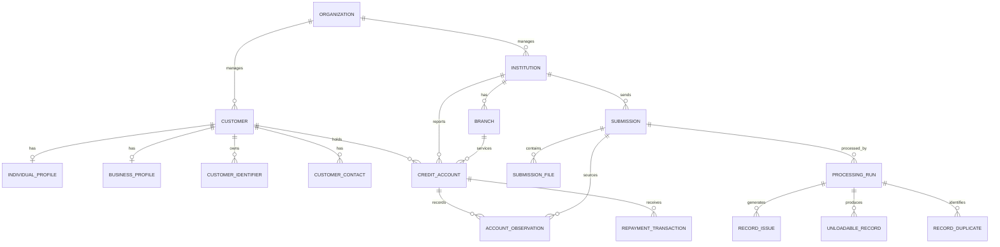

# CREDIT BUREAU SIMULATOR

## DOCUMENT 04 — DATABASE DESIGN AND DATA DICTIONARY

**Document ID:** CBS-DBD-001
**Version:** 0.1
**Status:** Initial Database Design Specification
**Project:** Credit Bureau Simulator
**Primary Market:** Ghana
**Primary Currency:** Ghana Cedi (GHS)
**Primary Database:** Microsoft SQL Server
**Backend:** Django + Django REST Framework

---

# 1. Document Purpose

This document defines the proposed database architecture for the Credit Bureau Simulator.

It translates the functional requirements and technical architecture into a practical relational database design.

The database must support:

* Organizational and employee management.
* Provider and subscriber management.
* Customer and business records.
* Credit facilities and repayment histories.
* Monthly credit data submissions.
* Data validation, cleansing and duplicate detection.
* Customer and account referencing.
* Credit reporting and enquiries.
* Credit analytics and scoring.
* Product management and sales.
* Financial accounting.
* Human resources and office management.
* Simulation activities and employee tasks.
* Compliance, audit and operational reporting.
* Future multiplayer and multi-bureau capabilities.

The design prioritizes data integrity, historical preservation, auditability, scalability and realistic credit bureau operations.

# 2. Database Design Principles

## 2.1 Relational database

Microsoft SQL Server will serve as the primary operational database.

The design will use relational tables, primary keys, foreign keys, indexes, constraints and transactions.

## 2.2 Logical schemas

The initial system will use one SQL Server database with multiple logical schemas.

| Schema         | Responsibility                               |
| -------------- | -------------------------------------------- |
| accounts       | Users, roles and permissions                 |
| org            | Organizations and departments                |
| hr             | Employees and employment records             |
| providers      | Data providers and branches                  |
| submissions    | Incoming files and processing runs           |
| quality        | Validation, cleansing and unloadable records |
| core           | Customers, facilities and credit histories   |
| analytics      | Datasets, features and model results         |
| products       | Bureau products and pricing                  |
| sales          | Leads, subscribers and contracts             |
| finance        | Accounting and financial transactions        |
| infrastructure | Office assets and IT infrastructure          |
| compliance     | Compliance cases and findings                |
| simulation     | Game sessions, tasks and simulation events   |
| audit          | Central audit records                        |

This avoids unnecessary database separation in Version 1 while preserving clear departmental boundaries.

## 2.3 Multi-tenancy readiness

Although Version 1 is primarily single-player, the database must support multiple organizations in the future.

Organizational records should carry an `organization_id` where appropriate.

This allows future versions to support multiple players working within one bureau or managing competing bureaus.

Application services must enforce organization-level access controls. Database constraints and integration tests should reinforce tenant isolation.

## 2.4 Historical preservation

Credit bureau data is time-dependent.

The system must preserve historical observations instead of replacing previous reporting periods.

For example:

* January: Facility balance = GHS 10,000.
* February: Facility balance = GHS 8,000.
* March: Facility balance = GHS 6,000.

These are three observations of one credit account, not three different accounts.

## 2.5 Data lineage

Every accepted customer, facility and monthly observation must be traceable to its source submission and source record.

The system must be able to answer:

* Which institution submitted this record?
* Which file contained it?
* When was it received?
* Which processing run handled it?
* Which validation rules were applied?
* Was it changed during cleansing?
* Was it accepted or rejected?
* Which source row produced the final database record?

# 3. Database Naming and Data Type Standards

## 3.1 Naming conventions

* Use lowercase schema names.
* Use singular or consistently named table entities.
* Use `snake_case` for table and column names.
* Use descriptive names rather than abbreviations.
* Primary keys should normally be named `id`.
* Foreign keys should identify the referenced entity, such as `customer_id`.
* Indexes should use descriptive prefixes.

Examples:

* `core.customer`
* `core.credit_account`
* `core.account_observation`
* `submissions.submission`
* `finance.journal_entry`

## 3.2 Primary keys

Use:

* `BIGINT IDENTITY(1,1)` for internal primary keys.
* `UNIQUEIDENTIFIER` for public-facing identifiers where records need externally safe references.

Sequential internal IDs should not be exposed directly through public APIs.

## 3.3 Standard data types

| Data type        | Application                        |
| ---------------- | ---------------------------------- |
| BIGINT           | Internal primary and foreign keys  |
| UNIQUEIDENTIFIER | Public identifiers                 |
| NVARCHAR(n)      | Names, descriptions and text       |
| NVARCHAR(MAX)    | Flexible JSON payloads             |
| DATE             | Business dates and reporting dates |
| DATETIME2(3)     | Timestamps                         |
| DECIMAL(19,4)    | Monetary values                    |
| DECIMAL(9,6)     | Ratios and percentages             |
| INT              | Counts and integer measures        |
| BIT              | Boolean values                     |
| VARBINARY(32)    | SHA-256 hashes                     |

All timestamps should be stored in UTC.

Financial calculations must use DECIMAL, never FLOAT or REAL.

# 4. Core Organizational Tables

## 4.1 Organization

**Table:** `org.organization`

Represents a bureau operating within the simulation.

| Column            | Type             | Nullable | Description                       |
| ----------------- | ---------------- | -------- | --------------------------------- |
| id                | BIGINT IDENTITY  | No       | Primary key                       |
| public_id         | UNIQUEIDENTIFIER | No       | External identifier               |
| name              | NVARCHAR(150)    | No       | Organization name                 |
| organization_code | NVARCHAR(30)     | No       | Unique organization code          |
| organization_type | NVARCHAR(30)     | No       | Bureau or other organization type |
| country_code      | CHAR(2)          | No       | Country                           |
| base_currency     | CHAR(3)          | No       | Default currency                  |
| created_at        | DATETIME2(3)     | No       | Creation timestamp                |
| is_active         | BIT              | No       | Active status                     |

## 4.2 Department

**Table:** `org.department`

Represents departments within an organization.

| Column              | Type            | Nullable | Description            |
| ------------------- | --------------- | -------- | ---------------------- |
| id                  | BIGINT IDENTITY | No       | Primary key            |
| organization_id     | BIGINT          | No       | Owning organization    |
| department_code     | NVARCHAR(30)    | No       | Department code        |
| department_name     | NVARCHAR(100)   | No       | Department name        |
| description         | NVARCHAR(500)   | Yes      | Department description |
| manager_employee_id | BIGINT          | Yes      | Department manager     |
| is_active           | BIT             | No       | Active status          |

## 4.3 User and Employee

Separate system accounts from employees.

**Tables:**

* `accounts.user`
* `hr.employee`
* `accounts.role`
* `accounts.permission`
* `accounts.organization_membership`
* `accounts.employee_assignment`

A user represents someone who can authenticate.

An employee represents a person employed by the bureau.

An employee may have a linked user account, but not every employee must have one.

The separation supports AI employees, simulated workers and future multiplayer users.

# 5. Provider and Subscriber Management

## 5.1 Provider institution

**Table:** `providers.institution`

Represents institutions that submit credit data.

Examples of synthetic institutions:

* Atlas Bank
* Meridian Bank
* Unity Savings
* SwiftCash
* Horizon Finance

| Column               | Type            | Nullable | Description                            |
| -------------------- | --------------- | -------- | -------------------------------------- |
| id                   | BIGINT IDENTITY | No       | Primary key                            |
| organization_id      | BIGINT          | No       | Bureau                                 |
| institution_code     | NVARCHAR(30)    | No       | Institution code                       |
| institution_name     | NVARCHAR(150)   | No       | Institution name                       |
| institution_type     | NVARCHAR(50)    | No       | Bank, fintech, savings and loans, etc. |
| contact_email        | NVARCHAR(150)   | Yes      | Contact email                          |
| onboarding_date      | DATE            | Yes      | Date onboarded                         |
| submission_frequency | NVARCHAR(30)    | No       | Expected submission frequency          |
| is_active            | BIT             | No       | Active status                          |

## 5.2 Provider branches

**Table:** `providers.branch`

Stores branches associated with institutions.

Important fields include:

* `id`
* `institution_id`
* `branch_code`
* `branch_name`
* `region`
* `address`
* `is_active`

Institution codes must be unique within the relevant bureau organization.

## 5.3 Subscribers

Subscribers are institutions or businesses purchasing bureau products.

The design should distinguish a provider relationship from a subscriber relationship.

An institution may be both a provider and a subscriber.

Subscriber records and agreements belong in the sales domain.

# 6. Customer Database

The customer database is one of the most important parts of the system.

A customer may be an individual or a business.

## 6.1 Customer master

**Table:** `core.customer`

| Column             | Type             | Nullable | Description                      |
| ------------------ | ---------------- | -------- | -------------------------------- |
| id                 | BIGINT IDENTITY  | No       | Primary key                      |
| public_id          | UNIQUEIDENTIFIER | No       | Public identifier                |
| organization_id    | BIGINT           | No       | Bureau                           |
| customer_type      | NVARCHAR(20)     | No       | INDIVIDUAL or BUSINESS           |
| customer_reference | NVARCHAR(50)     | No       | Internal bureau reference        |
| created_at         | DATETIME2(3)     | No       | Creation timestamp               |
| updated_at         | DATETIME2(3)     | No       | Last update                      |
| record_status      | NVARCHAR(30)     | No       | Active, inactive or under review |

## 6.2 Individual profile

**Table:** `core.individual_profile`

Contains individual-specific information.

| Column            | Type            | Nullable | Description              |
| ----------------- | --------------- | -------- | ------------------------ |
| id                | BIGINT IDENTITY | No       | Primary key              |
| customer_id       | BIGINT          | No       | Customer reference       |
| first_name        | NVARCHAR(100)   | No       | First name               |
| middle_name       | NVARCHAR(100)   | Yes      | Middle name              |
| last_name         | NVARCHAR(100)   | No       | Last name                |
| date_of_birth     | DATE            | Yes      | Date of birth            |
| gender_code       | NVARCHAR(20)    | Yes      | Recorded gender category |
| occupation        | NVARCHAR(100)   | Yes      | Occupation               |
| employment_status | NVARCHAR(50)    | Yes      | Employment status        |

Sensitive demographic attributes should be handled with restricted access and should not automatically become credit-scoring inputs.

## 6.3 Business profile

**Table:** `core.business_profile`

| Column              | Type            | Nullable | Description                |
| ------------------- | --------------- | -------- | -------------------------- |
| id                  | BIGINT IDENTITY | No       | Primary key                |
| customer_id         | BIGINT          | No       | Customer reference         |
| registered_name     | NVARCHAR(200)   | No       | Registered business name   |
| trading_name        | NVARCHAR(200)   | Yes      | Trading name               |
| registration_number | NVARCHAR(100)   | Yes      | Registration number        |
| tin_number          | NVARCHAR(100)   | Yes      | Tax identifier             |
| business_type       | NVARCHAR(50)    | Yes      | Business classification    |
| sector_code         | NVARCHAR(30)    | Yes      | Economic sector            |
| registration_date   | DATE            | Yes      | Registration date          |
| commencement_date   | DATE            | Yes      | Business commencement date |

## 6.4 Customer identifiers

**Table:** `core.customer_identifier`

Customer identifiers must be stored separately because one customer can have several identifiers.

Examples include synthetic Ghana Card, passport, voter identification and business registration references.

Important fields:

* `customer_id`
* `identifier_type`
* `issuer`
* `identifier_value`
* `identifier_hash`
* `valid_from`
* `valid_to`
* `verification_status`
* `source_submission_id`

Identifier values in this project must be synthetic.

Where identifiers are sensitive, apply encryption and access restrictions. Hashes should be used for controlled matching, with appropriate protection against predictable-value attacks.

## 6.5 Customer contact information

**Table:** `core.customer_contact`

Stores phone numbers, emails and addresses.

Important fields:

* `customer_id`
* `contact_type`
* `contact_value`
* `is_primary`
* `is_verified`
* `effective_from`
* `effective_to`
* `source_submission_id`

Historical contact information should be retained where necessary rather than silently overwritten.

# 7. Credit Account Database

## 7.1 Credit account master

**Table:** `core.credit_account`

A credit account represents a persistent credit relationship between a customer and a provider.

| Column                  | Type             | Nullable | Description                        |
| ----------------------- | ---------------- | -------- | ---------------------------------- |
| id                      | BIGINT IDENTITY  | No       | Primary key                        |
| public_id               | UNIQUEIDENTIFIER | No       | Public identifier                  |
| organization_id         | BIGINT           | No       | Bureau                             |
| customer_id             | BIGINT           | No       | Borrower                           |
| institution_id          | BIGINT           | No       | Reporting institution              |
| branch_id               | BIGINT           | Yes      | Reporting branch                   |
| facility_account_number | NVARCHAR(100)    | No       | Institution account reference      |
| facility_type           | NVARCHAR(50)     | No       | Loan, overdraft, lease, etc.       |
| currency_code           | CHAR(3)          | No       | Facility currency                  |
| disbursement_date       | DATE             | Yes      | Disbursement date                  |
| maturity_date           | DATE             | Yes      | Maturity date                      |
| original_amount         | DECIMAL(19,4)    | No       | Original facility amount           |
| account_status          | NVARCHAR(30)     | No       | Active, paid up, written off, etc. |
| created_at              | DATETIME2(3)     | No       | Creation timestamp                 |

The account number must be unique according to the institution's account-identification rules, not globally across every institution.

Account matching should use an agreed combination of institution, account number and other identifying attributes.

## 7.2 Monthly account observation

**Table:** `core.account_observation`

This table records the state of a credit account at a particular reporting date.

| Column               | Type            | Nullable | Description               |
| -------------------- | --------------- | -------- | ------------------------- |
| id                   | BIGINT IDENTITY | No       | Primary key               |
| credit_account_id    | BIGINT          | No       | Credit account            |
| reporting_date       | DATE            | No       | Reporting date            |
| outstanding_balance  | DECIMAL(19,4)   | No       | Outstanding balance       |
| principal_balance    | DECIMAL(19,4)   | Yes      | Principal outstanding     |
| interest_balance     | DECIMAL(19,4)   | Yes      | Interest outstanding      |
| arrears_amount       | DECIMAL(19,4)   | No       | Arrears amount            |
| days_past_due        | INT             | No       | Days in arrears           |
| payment_status       | NVARCHAR(30)    | No       | Payment condition         |
| facility_status      | NVARCHAR(30)    | No       | Facility status           |
| is_restructured      | BIT             | No       | Restructuring indicator   |
| is_written_off       | BIT             | No       | Write-off indicator       |
| source_submission_id | BIGINT          | No       | Source submission         |
| source_row_number    | INT             | Yes      | Original row number       |
| created_at           | DATETIME2(3)    | No       | Record creation timestamp |

**Critical rule:** One account should have no more than one current accepted observation per reporting date, unless a formally defined correction or versioning process applies.

Previous observations must not be deleted simply because a newer month has arrived.

## 7.3 Repayment transactions

**Table:** `core.repayment_transaction`

Where transaction-level repayment information is supplied, store it separately.

Important fields:

* `credit_account_id`
* `transaction_reference`
* `transaction_date`
* `transaction_type`
* `transaction_amount`
* `currency_code`
* `source_submission_id`

Monthly snapshots and repayment transactions serve different purposes and must not be mixed.

# 8. Submission Management

## 8.1 Submission register

**Table:** `submissions.submission`

Represents an incoming submission from a provider.

| Column                  | Type            | Nullable | Description            |
| ----------------------- | --------------- | -------- | ---------------------- |
| id                      | BIGINT IDENTITY | No       | Primary key            |
| organization_id         | BIGINT          | No       | Bureau                 |
| institution_id          | BIGINT          | No       | Provider               |
| submission_reference    | NVARCHAR(60)    | No       | Submission reference   |
| reporting_period        | DATE            | No       | Reporting period       |
| received_at             | DATETIME2(3)    | No       | Date and time received |
| received_by_employee_id | BIGINT          | Yes      | Receiving employee     |
| submission_status       | NVARCHAR(30)    | No       | Current status         |
| total_records           | INT             | No       | Submitted records      |
| created_at              | DATETIME2(3)    | No       | Creation timestamp     |

## 8.2 Submission files

**Table:** `submissions.submission_file`

A submission may contain one or multiple files.

Fields include:

* `submission_id`
* `file_name`
* `file_format`
* `file_size_bytes`
* `file_hash`
* `storage_path`
* `received_at`
* `file_status`

Original files should be stored outside SQL Server, with file metadata and storage references kept in the database.

## 8.3 Processing runs

**Table:** `submissions.processing_run`

Each processing attempt must be recorded independently.

Important fields:

* `submission_id`
* `run_number`
* `started_at`
* `completed_at`
* `processing_status`
* `records_received`
* `records_validated`
* `records_accepted`
* `records_rejected`
* `records_duplicated`
* `processed_by_employee_id`
* `processing_version`

This allows a corrected submission or reprocessing attempt to be tracked without destroying the original history.

# 9. Data Quality and Cleansing

The quality domain records what happened to submitted records.

## 9.1 Validation issues

**Table:** `quality.validation_issue`

Stores structural and business-rule validation errors.

Examples:

* Missing mandatory customer ID.
* Invalid reporting date.
* Incorrect facility amount.
* Invalid date format.
* Missing account number.

## 9.2 Record issues

**Table:** `quality.record_issue`

Stores record-level issues linked to a source row.

Fields include:

* `processing_run_id`
* `source_row_number`
* `field_name`
* `error_code`
* `error_description`
* `severity`
* `resolution_status`

## 9.3 Duplicate records

**Table:** `quality.record_duplicate`

Stores duplicate detection results.

Fields include:

* `processing_run_id`
* `source_row_number`
* `matched_record_type`
* `matched_record_id`
* `matching_method`
* `confidence_score`
* `review_status`

Possible matching methods include exact matching, normalized matching and rule-based matching.

Uncertain matches must be reviewed. The system must not automatically merge distinct customers based only on a weak similarity score.

## 9.4 Unloadable records

**Table:** `quality.unloadable_record`

Stores records rejected from loading.

Important fields:

* `processing_run_id`
* `source_row_number`
* `record_type`
* `error_summary`
* `error_details`
* `resolution_status`
* `corrected_submission_id`

The design should support multiple error messages for a single record.

## 9.5 Transformation logs

**Table:** `quality.transformation_log`

Records data transformations applied during cleansing.

Fields include:

* `processing_run_id`
* `source_row_number`
* `field_name`
* `original_value`
* `transformed_value`
* `transformation_rule`
* `transformed_at`

The system should preserve the original source file and make transformations reproducible.

# 10. Analytics and Credit Scoring

The analytics domain must support real calculations using stored bureau data.

## 10.1 Dataset

**Table:** `analytics.dataset`

Stores datasets created for analytical purposes.

## 10.2 Model

**Table:** `analytics.model`

Stores model definitions, including:

* Model name.
* Model type.
* Purpose.
* Description.
* Owner.
* Current status.

## 10.3 Model version

**Table:** `analytics.model_version`

Every deployed model version must be preserved.

Important fields:

* `model_id`
* `version_number`
* `training_dataset_id`
* `algorithm`
* `feature_set_version`
* `training_period_start`
* `training_period_end`
* `artifact_path`
* `approval_status`

## 10.4 Model metrics

**Table:** `analytics.model_metric`

Stores evaluation results, including:

* AUC.
* Precision.
* Recall.
* Accuracy.
* KS statistic.
* Gini coefficient.
* Calibration metrics.

## 10.5 Score results

**Table:** `analytics.score_result`

Every score should preserve:

* Customer reference.
* Model version.
* Score value.
* Score date.
* Input data cut-off date.
* Risk band.
* Score explanation reference.

A new model version must not overwrite previous score results.

Sensitive demographic attributes may be used in controlled fairness evaluations but should not automatically be included as scoring variables.

# 11. Products and Sales

## 11.1 Product catalogue

**Table:** `products.product`

Initial products:

* Individual Credit Report.
* Business Credit Report.
* Batch Credit Enquiry.

Important fields:

* `product_code`
* `product_name`
* `description`
* `product_category`
* `is_active`

## 11.2 Product pricing

**Table:** `products.product_price`

Pricing must be versioned so that previous prices remain available for historical invoices and revenue analysis.

## 11.3 Sales records

Recommended tables:

* `sales.lead`
* `sales.opportunity`
* `sales.subscriber`
* `sales.contract`
* `sales.subscription`

These support the commercial lifecycle from prospecting to onboarding and recurring revenue.

# 12. Finance and Accounting

The finance module must implement real double-entry accounting.

## 12.1 Chart of accounts

**Table:** `finance.account`

Represents ledger accounts.

Examples:

* Cash.
* Bank.
* Accounts Receivable.
* Accounts Payable.
* Revenue.
* Salaries Expense.
* Rent Expense.
* IT Infrastructure Expense.

## 12.2 Journal entry

**Table:** `finance.journal_entry`

Represents an accounting transaction.

Important fields:

* `organization_id`
* `journal_reference`
* `transaction_date`
* `description`
* `posting_status`
* `posted_at`
* `created_by_user_id`
* `reversal_of_journal_id`

## 12.3 Journal line

**Table:** `finance.journal_line`

Contains the debit and credit entries.

Important fields:

* `journal_entry_id`
* `account_id`
* `debit_amount`
* `credit_amount`
* `description`

A posted journal must satisfy:

**Total Debits = Total Credits**

This must be enforced by the finance posting service inside a database transaction. A row-level CHECK constraint alone cannot validate the balance across multiple journal lines.

Posted journals must not be edited or deleted. Corrections should be made through reversal and replacement entries.

## 12.4 Supporting finance tables

* `finance.invoice`
* `finance.invoice_line`
* `finance.payment`
* `finance.supplier`
* `finance.bank_account`

The financial reports must derive from posted transactions, not manually entered dashboard figures.

# 13. Simulation and Game Management

The simulation module connects business operations to the game world.

Recommended tables:

| Table                       | Purpose                         |
| --------------------------- | ------------------------------- |
| simulation.game_session     | Individual game sessions        |
| simulation.scenario         | Starting business scenarios     |
| simulation.difficulty       | Difficulty configurations       |
| simulation.simulation_state | Current simulation state        |
| simulation.task             | Employee tasks                  |
| simulation.task_dependency  | Task dependencies               |
| simulation.event            | Business and economic events    |
| simulation.employee_state   | Employee availability and state |

The backend controls simulation time and task progression.

The browser must not be the authoritative source of business events or financial transactions.

# 14. Infrastructure, Compliance and Audit

## 14.1 Infrastructure

Recommended tables:

* `infrastructure.asset`
* `infrastructure.asset_category`
* `infrastructure.maintenance_record`
* `infrastructure.incident`

These represent office equipment, servers, software licences and infrastructure incidents.

## 14.2 Compliance

Recommended tables:

* `compliance.audit_case`
* `compliance.audit_finding`
* `compliance.dispute_case`
* `compliance.access_log`

## 14.3 Central audit log

**Table:** `audit.audit_event`

Every significant business action should be traceable.

Fields include:

* `organization_id`
* `actor_user_id`
* `actor_employee_id`
* `action`
* `entity_type`
* `entity_id`
* `event_timestamp`
* `correlation_id`
* `before_state`
* `after_state`
* `reason`

Audit records should be append-only under normal application operations.

# 15. Entity Relationship Overview

The following relationships define the core credit bureau data model.



# 16. Initial SQL Server DDL

The following SQL establishes the core structure. It is a starting migration blueprint, not the complete production schema.

## 16.1 Create database and schemas

```sql
CREATE DATABASE CreditBureauSimulator;
GO

USE CreditBureauSimulator;
GO

CREATE SCHEMA org;
GO
CREATE SCHEMA providers;
GO
CREATE SCHEMA core;
GO
CREATE SCHEMA submissions;
GO
CREATE SCHEMA quality;
GO
CREATE SCHEMA finance;
GO
CREATE SCHEMA audit;
GO
```

The remaining schemas should be created as their respective modules are implemented.

## 16.2 Organization table

```sql
CREATE TABLE org.organization (
    id BIGINT IDENTITY(1,1) PRIMARY KEY,
    public_id UNIQUEIDENTIFIER NOT NULL
        DEFAULT NEWID(),
    name NVARCHAR(150) NOT NULL,
    organization_code NVARCHAR(30) NOT NULL,
    organization_type NVARCHAR(30) NOT NULL,
    country_code CHAR(2) NOT NULL DEFAULT 'GH',
    base_currency CHAR(3) NOT NULL DEFAULT 'GHS',
    created_at DATETIME2(3) NOT NULL
        DEFAULT SYSUTCDATETIME(),
    is_active BIT NOT NULL DEFAULT 1,

    CONSTRAINT UQ_organization_public_id
        UNIQUE (public_id),

    CONSTRAINT UQ_organization_code
        UNIQUE (organization_code)
);
GO
```

## 16.3 Provider institution

```sql
CREATE TABLE providers.institution (
    id BIGINT IDENTITY(1,1) PRIMARY KEY,
    organization_id BIGINT NOT NULL,
    institution_code NVARCHAR(30) NOT NULL,
    institution_name NVARCHAR(150) NOT NULL,
    institution_type NVARCHAR(50) NOT NULL,
    contact_email NVARCHAR(150) NULL,
    onboarding_date DATE NULL,
    submission_frequency NVARCHAR(30) NOT NULL,
    is_active BIT NOT NULL DEFAULT 1,

    CONSTRAINT FK_institution_organization
        FOREIGN KEY (organization_id)
        REFERENCES org.organization(id),

    CONSTRAINT UQ_institution_org_code
        UNIQUE (organization_id, institution_code)
);
GO
```

## 16.4 Customer master

```sql
CREATE TABLE core.customer (
    id BIGINT IDENTITY(1,1) PRIMARY KEY,
    public_id UNIQUEIDENTIFIER NOT NULL
        DEFAULT NEWID(),
    organization_id BIGINT NOT NULL,
    customer_type NVARCHAR(20) NOT NULL,
    customer_reference NVARCHAR(50) NOT NULL,
    record_status NVARCHAR(30) NOT NULL DEFAULT 'ACTIVE',
    created_at DATETIME2(3) NOT NULL
        DEFAULT SYSUTCDATETIME(),
    updated_at DATETIME2(3) NOT NULL
        DEFAULT SYSUTCDATETIME(),

    CONSTRAINT FK_customer_organization
        FOREIGN KEY (organization_id)
        REFERENCES org.organization(id),

    CONSTRAINT UQ_customer_public_id
        UNIQUE (public_id),

    CONSTRAINT UQ_customer_reference
        UNIQUE (organization_id, customer_reference),

    CONSTRAINT CK_customer_type
        CHECK (customer_type IN ('INDIVIDUAL', 'BUSINESS'))
);
GO
```

## 16.5 Credit account

```sql
CREATE TABLE core.credit_account (
    id BIGINT IDENTITY(1,1) PRIMARY KEY,
    public_id UNIQUEIDENTIFIER NOT NULL
        DEFAULT NEWID(),
    organization_id BIGINT NOT NULL,
    customer_id BIGINT NOT NULL,
    institution_id BIGINT NOT NULL,
    branch_id BIGINT NULL,
    facility_account_number NVARCHAR(100) NOT NULL,
    facility_type NVARCHAR(50) NOT NULL,
    currency_code CHAR(3) NOT NULL DEFAULT 'GHS',
    disbursement_date DATE NULL,
    maturity_date DATE NULL,
    original_amount DECIMAL(19,4) NOT NULL,
    account_status NVARCHAR(30) NOT NULL,
    created_at DATETIME2(3) NOT NULL
        DEFAULT SYSUTCDATETIME(),

    CONSTRAINT FK_credit_account_customer
        FOREIGN KEY (customer_id)
        REFERENCES core.customer(id),

    CONSTRAINT FK_credit_account_institution
        FOREIGN KEY (institution_id)
        REFERENCES providers.institution(id),

    CONSTRAINT UQ_credit_account_public_id
        UNIQUE (public_id)
);
GO
```

The initial migration must additionally implement organization-consistency validation between the customer, institution and account. Composite tenant-scoped foreign keys are preferred for critical records as the schema matures.

## 16.6 Account observation

```sql
CREATE TABLE core.account_observation (
    id BIGINT IDENTITY(1,1) PRIMARY KEY,
    credit_account_id BIGINT NOT NULL,
    reporting_date DATE NOT NULL,
    outstanding_balance DECIMAL(19,4) NOT NULL,
    principal_balance DECIMAL(19,4) NULL,
    interest_balance DECIMAL(19,4) NULL,
    arrears_amount DECIMAL(19,4) NOT NULL DEFAULT 0,
    days_past_due INT NOT NULL DEFAULT 0,
    payment_status NVARCHAR(30) NOT NULL,
    facility_status NVARCHAR(30) NOT NULL,
    is_restructured BIT NOT NULL DEFAULT 0,
    is_written_off BIT NOT NULL DEFAULT 0,
    source_submission_id BIGINT NOT NULL,
    source_row_number INT NULL,
    created_at DATETIME2(3) NOT NULL
        DEFAULT SYSUTCDATETIME(),

    CONSTRAINT FK_observation_credit_account
        FOREIGN KEY (credit_account_id)
        REFERENCES core.credit_account(id),

    CONSTRAINT CK_observation_days_past_due
        CHECK (days_past_due >= 0),

    CONSTRAINT UQ_account_reporting_date
        UNIQUE (credit_account_id, reporting_date)
);
GO
```

The unique constraint represents one accepted observation per account and reporting date in the initial design. A controlled correction process must be defined before permitting replacement observations.

## 16.7 Submission

```sql
CREATE TABLE submissions.submission (
    id BIGINT IDENTITY(1,1) PRIMARY KEY,
    organization_id BIGINT NOT NULL,
    institution_id BIGINT NOT NULL,
    submission_reference NVARCHAR(60) NOT NULL,
    reporting_period DATE NOT NULL,
    received_at DATETIME2(3) NOT NULL
        DEFAULT SYSUTCDATETIME(),
    submission_status NVARCHAR(30) NOT NULL DEFAULT 'RECEIVED',
    total_records INT NOT NULL DEFAULT 0,
    created_at DATETIME2(3) NOT NULL
        DEFAULT SYSUTCDATETIME(),

    CONSTRAINT FK_submission_institution
        FOREIGN KEY (institution_id)
        REFERENCES providers.institution(id),

    CONSTRAINT UQ_submission_reference
        UNIQUE (organization_id, submission_reference)
);
GO
```

## 16.8 Finance journal entry

```sql
CREATE TABLE finance.journal_entry (
    id BIGINT IDENTITY(1,1) PRIMARY KEY,
    organization_id BIGINT NOT NULL,
    journal_reference NVARCHAR(60) NOT NULL,
    transaction_date DATE NOT NULL,
    description NVARCHAR(500) NOT NULL,
    posting_status NVARCHAR(20) NOT NULL DEFAULT 'DRAFT',
    posted_at DATETIME2(3) NULL,
    reversal_of_journal_id BIGINT NULL,
    created_at DATETIME2(3) NOT NULL
        DEFAULT SYSUTCDATETIME(),

    CONSTRAINT UQ_journal_reference
        UNIQUE (organization_id, journal_reference)
);
GO
```

## 16.9 Finance journal line

```sql
CREATE TABLE finance.journal_line (
    id BIGINT IDENTITY(1,1) PRIMARY KEY,
    journal_entry_id BIGINT NOT NULL,
    account_id BIGINT NOT NULL,
    debit_amount DECIMAL(19,4) NOT NULL DEFAULT 0,
    credit_amount DECIMAL(19,4) NOT NULL DEFAULT 0,
    description NVARCHAR(300) NULL,

    CONSTRAINT FK_journal_line_entry
        FOREIGN KEY (journal_entry_id)
        REFERENCES finance.journal_entry(id),

    CONSTRAINT CK_journal_line_amounts
        CHECK (
            debit_amount >= 0
            AND credit_amount >= 0
            AND NOT (
                debit_amount > 0
                AND credit_amount > 0
            )
        )
);
GO
```

The finance service must validate that every journal has at least two appropriate lines and that total debits equal total credits before posting.

# 17. Indexing Strategy

Indexes should support the most frequent operational queries.

| Table                      | Suggested index                              |
| -------------------------- | -------------------------------------------- |
| providers.institution      | organization_id, institution_code            |
| submissions.submission     | organization_id, institution_id, received_at |
| submissions.processing_run | submission_id, processing_status             |
| core.customer              | organization_id, customer_reference          |
| core.customer_identifier   | identifier_type, identifier_hash             |
| core.credit_account        | organization_id, customer_id                 |
| core.credit_account        | institution_id, facility_account_number      |
| core.account_observation   | credit_account_id, reporting_date            |
| quality.unloadable_record  | processing_run_id, resolution_status         |
| finance.journal_entry      | organization_id, transaction_date            |
| finance.journal_line       | account_id, journal_entry_id                 |
| simulation.task            | organization_id, task_status, priority       |

Avoid creating indexes indiscriminately. Indexes improve reads but increase storage and write costs.

# 18. Data Staging and Loading Strategy

Incoming data must not be loaded directly into production credit tables.

The preferred process is:

1. Receive the original file.
2. Register the submission and file metadata.
3. Store the original file in controlled file storage.
4. Load records into staging tables.
5. Run structural validation.
6. Run field-level validation.
7. Apply approved cleansing transformations.
8. Detect duplicates.
9. Match customers and existing accounts.
10. Separate accepted and unloadable records.
11. Load accepted records into core tables.
12. Record processing statistics and audit events.

Staging tables should preserve source row numbers and submission references.

A flexible raw JSON payload can be retained where appropriate, but normalized staging tables should be used for the core templates.

# 19. Data Integrity and Correction Rules

The following rules are mandatory:

1. A customer must have one stable bureau customer reference.
2. A facility must have one persistent account identity.
3. Monthly submissions must not automatically create new facilities.
4. Historical observations must be preserved.
5. Duplicate detection must distinguish customer duplicates from account duplicates.
6. Every accepted observation must have source lineage.
7. Corrections must be auditable.
8. Uncertain customer matches must be reviewed.
9. Posted financial journals must not be edited or deleted.
10. Credit scores must retain their model version and input data cut-off date.
11. Organization boundaries must be enforced in application services and tested.
12. All project data must be synthetic.

For corrections, use a controlled supersession or correction record that identifies the original observation, replacement observation, reason, source submission and approving actor. Do not silently overwrite historical data.

# 20. Django Integration

Django models and migrations will be the principal mechanism for managing database schema changes.

Recommended practices:

* Organize models by Django application.
* Use explicit `db_table` declarations where necessary.
* Keep database migrations under version control.
* Use service-layer transactions for multi-table operations.
* Use database constraints for enforceable integrity rules.
* Test SQL Server-specific behavior.
* Avoid manual production schema changes outside controlled migrations.

The SQL Server backend and Django version combination must be tested before committing to the final implementation.

# 21. Security and Privacy

The simulator must use synthetic customer and institution data.

Controls should include:

* Role-based access control.
* Organization-level access restrictions.
* Restricted access to identifiers and sensitive contact information.
* Audit trails for sensitive record access.
* Encryption for sensitive values where appropriate.
* Controlled backups.
* Safe handling of uploaded files.
* No real customer records in development or test environments.

The project is an educational simulation and does not by itself establish regulatory compliance.

# 22. Version 1 Database Scope

The first implementation should prioritize the following tables.

**Phase 1 — Foundation**

* Organization
* Department
* User
* Employee
* Role
* Institution
* Branch

**Phase 2 — Bureau Core**

* Customer
* Individual Profile
* Business Profile
* Customer Identifier
* Customer Contact
* Credit Account
* Account Observation
* Repayment Transaction

**Phase 3 — Data Operations**

* Submission
* Submission File
* Processing Run
* Validation Issue
* Record Issue
* Record Duplicate
* Unloadable Record
* Transformation Log

**Phase 4 — Business Operations**

* Product
* Product Price
* Subscriber
* Contract
* Invoice
* Payment
* Chart of Accounts
* Journal Entry
* Journal Line

**Phase 5 — Simulation and Analytics**

* Game Session
* Simulation State
* Simulation Task
* Simulation Event
* Dataset
* Model
* Model Version
* Model Metric
* Score Result

# 23. Database Acceptance Criteria

The database design will be considered ready for implementation when:

1. All core entities have defined primary keys.
2. All required relationships have defined foreign keys.
3. Customer and business profiles are separated correctly.
4. A customer can hold multiple credit accounts.
5. A credit account can have multiple monthly observations.
6. Duplicate account observations for the same reporting date are controlled.
7. Every observation can be traced to its source submission.
8. Unloadable records can be identified and reviewed.
9. Historical data can be retained after corrections.
10. Financial journals can be validated for double-entry balance.
11. Organization-level data isolation can be tested.
12. Django migrations can create the required SQL Server structures.
13. Synthetic data can be loaded and queried successfully.

# 24. Dependencies and Next Document

This document depends on:

* Document 01 — Product Requirements Document.
* Document 02 — Functional Specification.
* Document 03 — Technical Architecture and System Design.

The next document should be:

**Document 05 — Game World and Simulation Design**

It will define the office environment, departments, employees, tasks, simulation clock, AI employee behavior, game progression, scenarios and economic events.

After that, the project should move toward the development roadmap and implementation.

---

**END OF DOCUMENT 04**

**Document ID:** CBS-DBD-001
**Version:** 0.1
**Status:** Initial Database Design Specification
